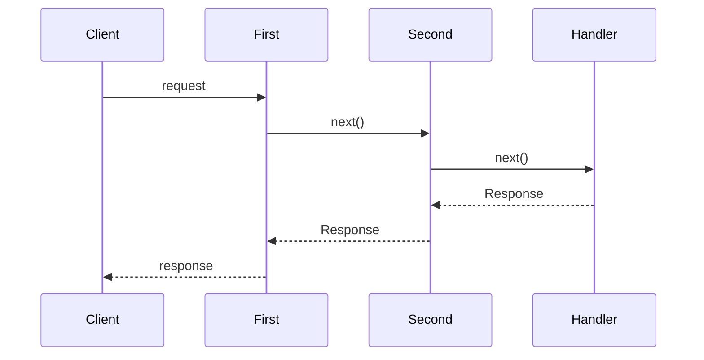

```ts twoslash
import { createApp } from "@senrijs/senri";

const app = createApp();

app.use(async (c, next) => {
    const start = performance.now();
    const res = await next();                 // run downstream (later middleware and the handler)
    c.header("x-response-time", `${performance.now() - start}ms`);
    return res;
});

// only for /admin and below
app.use("/admin", (c, next) => {
    if (c.req.headers.get("authorization") !== "secret") {
        c.status(401);
        return "please log in";               // returning a value ends here
    }
    return next();
});
```

## The onion

Middleware goes in from the outside in the order it was registered, and after the handler, comes back out in reverse order. Code before `await next()` runs on the way in, and code after it on the way out.



- **Returning a value stops:** if middleware returns a value without calling `next()`, nothing after it runs. The value becomes the response by the same rules as for handlers
- **The route is decided first:** routes match before middleware runs, so `c.route` (`"/users/:id"`) and `c.params` can be read before `next()`
- **Paths:** `app.use("/admin", mw)` runs for `/admin` and below. `app.use("/admin/*", mw)` means the same

In development mode, you can see which middleware each request went through, in which order and how many milliseconds each took ([Onion timeline](/en/docs/dev/timeline)).

## Pass values

To pass values from middleware to the handler, use `c.set()` and `c.get()`. Write the middleware as `Middleware<{ user: User }>` to type them.

```ts twoslash
import { createApp, type Middleware } from "@senrijs/senri";
type User = { name: string };
declare function findUser(token: string | null): Promise<User | undefined>;
// ---cut---
const auth: Middleware<{ user: User }> = async (c, next) => {
    const user = await findUser(c.req.headers.get("authorization"));
    if (!user) {
        c.status(401);
        return "please log in";
    }
    c.set("user", user);
    await next();
};

const app = createApp<{ user: User }>();
app.use("/me", auth);
app.get("/me", (_, c) => {
    const user = c.get("user");
    //    ^?
    return { name: user?.name };
});
```

Set the app's types as in `createApp<{ user: User }>()`. The types of middleware added per route apply to `c.get()` in that route ([Per-route middleware](/en/docs/middleware/route-middleware)).

## Built-in middleware

Common middleware is built in ([Built-in middleware](/en/docs/built-in)).
