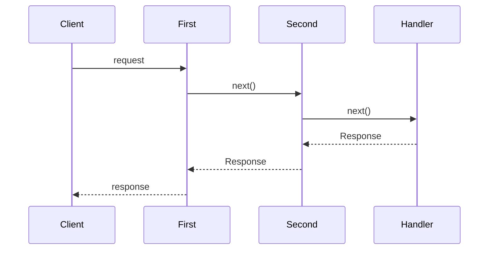

```ts twoslash
import { createApp } from "@senrijs/senri";

const app = createApp();

app.use(async (c, next) => {
    const start = performance.now();
    const res = await next();                 // run downstream (later middleware and the handler)
    c.header("x-response-time", `${performance.now() - start}ms`);
    return res;
});

// only for /admin and below
app.use("/admin", (c, next) => {
    if (c.req.headers.get("authorization") !== "secret") {
        c.status(401);
        return "please log in";               // returning a value ends here
    }
    return next();
});
```

## The onion

Middleware goes in from the outside in the order it was registered, and after the handler, comes back out in reverse order. Code before `await next()` runs on the way in, and code after it on the way out.



- **Returning a value stops:** if middleware returns a value without calling `next()`, nothing after it runs. The value becomes the response by the same rules as for handlers
- **The route is decided first:** routes match before middleware runs, so `c.route` (`"/users/:id"`) and `c.params` can be read before `next()`
- **Paths:** `app.use("/admin", mw)` runs for `/admin` and below. `app.use("/admin/*", mw)` means the same

In development mode, you can see which middleware each request went through, in which order and how many milliseconds each took ([Onion timeline](/en/docs/dev/timeline)).

## Pass values

To pass values from middleware to the handler, use `c.set()` and `c.get()`.

The second type argument of `Middleware` declares the variables the middleware always sets (`vars`) and the statuses it may throw (`errors`). Put it in a route's `use`, and `c.get()` in that route has no `undefined`.

```ts twoslash
import { createApp, HttpError, type Middleware } from "@senrijs/senri";
type User = { name: string };
declare function findUser(token: string | null): Promise<User | undefined>;
// ---cut---
// First: the app type it reads. Second: the variables it always sets and the statuses it may throw
const requireUser: Middleware<{}, { vars: { user: User }; errors: 401 }> = async (c, next) => {
    const user = await findUser(c.req.headers.get("authorization"));
    if (!user) throw new HttpError(401, "401 Unauthorized");
    c.set("user", user);
    return next();
};

const app = createApp();
app.get("/me", { use: [requireUser] }, (_, c) => {
    const user = c.get("user");
    //    ^?
    return { name: user.name };
});
```

- The statuses in `errors` show up in the types of the [typed client](/en/docs/typed-api/client)
- **`vars` is a promise made by whoever declares it. Senri does not check it at runtime.** If the middleware forgets `c.set()`, the type (`User`) and the value (`undefined`) disagree. Once declared, always set it before calling `next()`
- For middleware added with `app.use()`, the types cannot follow which routes it runs before. Type its variables with `createApp<{ user: User }>()`; `c.get()` then includes `undefined`

How to add middleware to routes, and what the built-in middleware declares, is in [Per-route middleware](/en/docs/middleware/route-middleware).

## Built-in middleware

Common middleware is built in ([Built-in middleware](/en/docs/built-in)).
