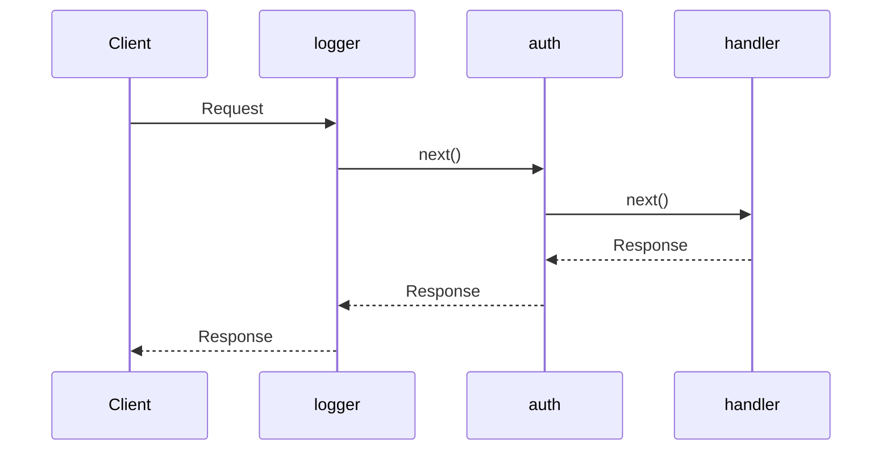

## Type hints (Twoslash)

Add `twoslash` to a code block to show types when you hover over an identifier. The types of `@senrijs/senri` are read from `src` in the repository.

```ts twoslash
import { createApp } from "@senrijs/senri";

const app = createApp();
app.get("/users/:id", ({ id }) => `user ${id}`);
//                       ^?
```

```ts twoslash
import { createApp } from "@senrijs/senri";
import { multipart } from "@senrijs/senri/multipart";

const app = createApp();
app.post("/upload", async (_, c) => {
    for await (const part of multipart(c, { maxFileSize: 100 * 1024 * 1024 })) {
        part.filename;
        //   ^?
    }
    return "ok";
});
```

## Options table (AutoTypeTable)

A table generated from the `MultipartLimits` type of `multipart()`. The descriptions come from the JSDoc in `src/multipart.ts`.

<AutoTypeTable path="../../src/multipart.ts" name="MultipartLimits" />

## Install commands

```npm
npm i @senrijs/senri
```

```npm
npm create senri@latest
```

## Diagrams (Mermaid)



## File tree

<Files>
    <Folder name="my-app" defaultOpen>
        <Folder name="src" defaultOpen>
            <File name="index.ts" />
        </Folder>
        <File name="package.json" />
        <File name="tsconfig.json" />
    </Folder>
</Files>

## Steps

<Steps>
<Step>

### Install

```npm
npm i @senrijs/senri
```

</Step>
<Step>

### Write a route

```ts
import { createApp } from "@senrijs/senri";

const app = createApp();
app.get("/", () => "Hello");

export default app;
```

</Step>
<Step>

### Start the server

```ts
import { serve } from "@senrijs/senri/serve";

await serve(app);
```

</Step>
</Steps>

## Callouts

<Callout title="Tip">A regular callout.</Callout>

<Callout type="warn" title="Warning">Something to be careful about.</Callout>

<Callout type="error" title="Danger">Something you must not do.</Callout>

## Tabs

<Tabs items={["Bun", "Deno", "Node.js"]}>
    <Tab value="Bun">`bun run index.ts`</Tab>
    <Tab value="Deno">`deno run -A index.ts`</Tab>
    <Tab value="Node.js">`node index.ts`</Tab>
</Tabs>
