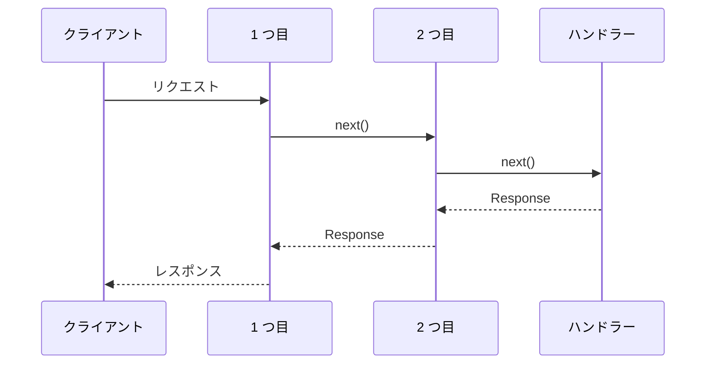

```ts twoslash
import { createApp } from "@senrijs/senri";

const app = createApp();

app.use(async (c, next) => {
    const start = performance.now();
    const res = await next();                 // 下流(後ろのミドルウェアとハンドラー)を動かす
    c.header("x-response-time", `${performance.now() - start}ms`);
    return res;
});

// /admin とその下だけで動く
app.use("/admin", (c, next) => {
    if (c.req.headers.get("authorization") !== "secret") {
        c.status(401);
        return "ログインしてね";              // 値を返したら、そこで終わり
    }
    return next();
});
```

{/* verify: after-next */}

## 玉ねぎの形

ミドルウェアは、登録した順に外から内へ入り、ハンドラーのあと、逆の順に外へ出ます。`await next()` の前が「入るとき」、後が「出るとき」です。 {/* verify: onion */}



- **値を返すと止まる:** `next()` を呼ばずに値を返すと、後ろは動きません。返した値が、ハンドラーと同じ決まりでレスポンスになります {/* verify: return-stops */}
- **ルートは先に決まる:** ミドルウェアより先にルートに当たるので、`next()` の前から `c.route`(`"/users/:id"`)と `c.params` が読めます
- **パスを付ける:** `app.use("/admin", mw)` は、`/admin` とその下で動きます。`app.use("/admin/*", mw)` も同じ意味です {/* verify: path */}

開発モードでは、どのミドルウェアを、どの順に、何ミリ秒で通ったかを見られます([玉ねぎのタイムライン](/docs/dev/timeline))。

## 値を渡す

ミドルウェアからハンドラーへ値を渡すには、`c.set()` と `c.get()` を使います。 {/* verify: set-get */}

`Middleware` の 2 つ目の型引数で、そのミドルウェアが「必ず入れる変数」(`vars`)と「投げうる状態コード」(`errors`)を宣言できます。ルートの `use` に入れると、そのルートの `c.get()` から `undefined` が消えます。 {/* verify: declared-vars */}

```ts twoslash
import { createApp, HttpError, type Middleware } from "@senrijs/senri";
type User = { name: string };
declare function findUser(token: string | null): Promise<User | undefined>;
// ---cut---
// 1 つ目: 読むアプリの型。2 つ目: 必ず入れる変数と、投げうる状態コード
const requireUser: Middleware<{}, { vars: { user: User }; errors: 401 }> = async (c, next) => {
    const user = await findUser(c.req.headers.get("authorization"));
    if (!user) throw new HttpError(401, "401 Unauthorized");
    c.set("user", user);
    return next();
};

const app = createApp();
app.get("/me", { use: [requireUser] }, (_, c) => {
    const user = c.get("user");
    //    ^?
    return { name: user.name };
});
```

- `errors` に書いた状態コードは、[型付きクライアント](/docs/typed-api/client)の型に出ます
- **`vars` は、宣言した人の約束です。Senri は実行時に確かめません。** `c.set()` を忘れると、型(`User`)と値(`undefined`)が食い違います。宣言したら、`next()` を呼ぶ前に必ず入れてください

全部のルートに付けるときは、`app.use()` の戻り値を使います。`app.use()` はアプリを返すので、つなげて書けます。つないだアプリに登録したルートでは、宣言した変数の `c.get()` から `undefined` が消えます。 {/* verify: app-use-vars */}

```ts twoslash
import { createApp, type Middleware } from "@senrijs/senri";
type User = { name: string };
declare const requireUser: Middleware<{}, { vars: { user: User }; errors: 401 }>;
// ---cut---
const app = createApp().use(requireUser);
app.get("/me", (_, c) => {
    const user = c.get("user");
    //    ^?
    return { name: user.name };
});
```

- `app.use()` は、それより前に登録したルートでも動きます。ただ、型が付くのは、戻り値(つないだあとのアプリ)に登録したルートだけです。`const app = createApp().use(requireUser)` のように、作るときにつなげてください
- パスを付けた `app.use("/admin", mw)` は、型を変えません。パスの下のルートで型を付けたいときは、[`createRouter("/admin", { use })`](/docs/middleware/route-middleware) を使います
- その場で書いたミドルウェア(`app.use(async (c, next) => ...)`)の `c` にも、それより前の `use` が入れる変数が付きます
- `app.onError()` と `app.notFound()` の `c` には付きません。`requireUser` が投げたあとにも呼ばれるためです

付け方と、標準のミドルウェアの宣言は、[ルートごとに付ける](/docs/middleware/route-middleware)にまとめています。

## 標準のミドルウェア

よく使うものは、標準で入っています([ミドルウェアの一覧](/docs/built-in))。
