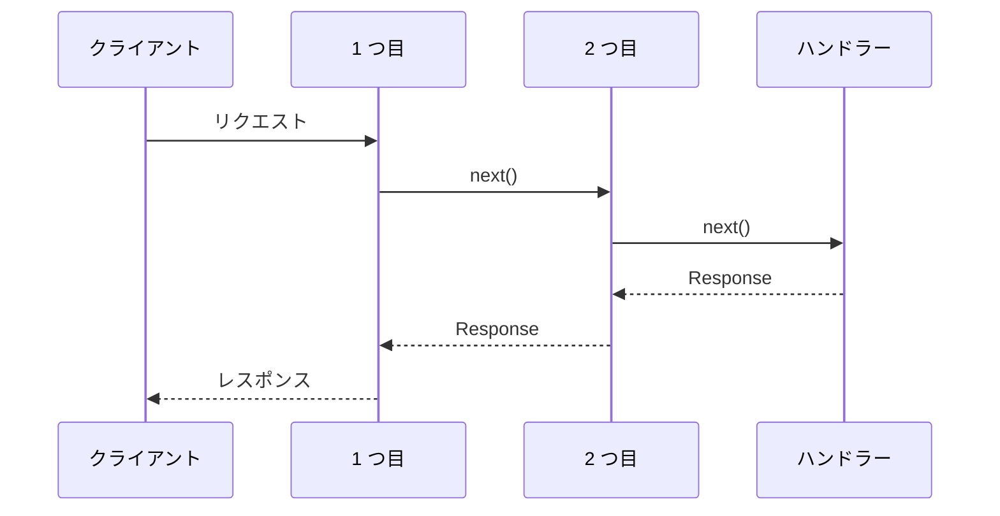

```ts twoslash
import { createApp } from "@senrijs/senri";

const app = createApp();

app.use(async (c, next) => {
    const start = performance.now();
    const res = await next();                 // 下流(後ろのミドルウェアとハンドラー)を動かす
    c.header("x-response-time", `${performance.now() - start}ms`);
    return res;
});

// /admin とその下だけで動く
app.use("/admin", (c, next) => {
    if (c.req.headers.get("authorization") !== "secret") {
        c.status(401);
        return "ログインしてね";              // 値を返したら、そこで終わり
    }
    return next();
});
```

## 玉ねぎの形

ミドルウェアは、登録した順に外から内へ入り、ハンドラーのあと、逆の順に外へ出ます。`await next()` の前が「入るとき」、後が「出るとき」です。



- **値を返すと止まる:** `next()` を呼ばずに値を返すと、後ろは動きません。返した値が、ハンドラーと同じ決まりでレスポンスになります
- **ルートは先に決まる:** ミドルウェアより先にルートに当たるので、`next()` の前から `c.route`(`"/users/:id"`)と `c.params` が読めます
- **パスを付ける:** `app.use("/admin", mw)` は、`/admin` とその下で動きます。`app.use("/admin/*", mw)` も同じ意味です

開発モードでは、どのミドルウェアを、どの順に、何ミリ秒で通ったかを見られます([玉ねぎのタイムライン](/docs/dev/timeline))。

## 値を渡す

ミドルウェアからハンドラーへ値を渡すには、`c.set()` と `c.get()` を使います。ミドルウェアを `Middleware<{ user: User }>` と書くと、その型が付きます。

```ts twoslash
import { createApp, type Middleware } from "@senrijs/senri";
type User = { name: string };
declare function findUser(token: string | null): Promise<User | undefined>;
// ---cut---
const auth: Middleware<{ user: User }> = async (c, next) => {
    const user = await findUser(c.req.headers.get("authorization"));
    if (!user) {
        c.status(401);
        return "ログインしてね";
    }
    c.set("user", user);
    await next();
};

const app = createApp<{ user: User }>();
app.use("/me", auth);
app.get("/me", (_, c) => {
    const user = c.get("user");
    //    ^?
    return { name: user?.name };
});
```

アプリ全体の型は、`createApp<{ user: User }>()` のように決めます。ルートごとに付けたミドルウェアの型は、そのルートの `c.get()` に付きます([ルートごとに付ける](/docs/middleware/route-middleware))。

## 標準のミドルウェア

よく使うものは、標準で入っています([ミドルウェアの一覧](/docs/built-in))。
