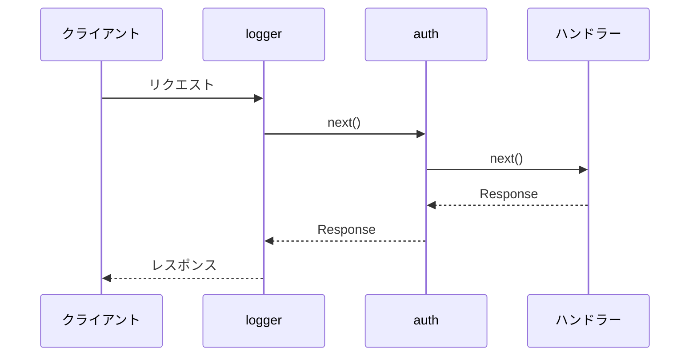

## 型のヒント(Twoslash)

コードブロックに `twoslash` を付けると、識別子にカーソルを合わせたときに型が出ます。`@senrijs/senri` の型は、リポジトリの `src` から読んでいます。

```ts twoslash
import { createApp } from "@senrijs/senri";

const app = createApp();
app.get("/users/:id", ({ id }) => `user ${id}`);
//                       ^?
```

```ts twoslash
import { createApp } from "@senrijs/senri";
import { multipart } from "@senrijs/senri/multipart";

const app = createApp();
app.post("/upload", async (_, c) => {
    for await (const part of multipart(c, { maxFileSize: 100 * 1024 * 1024 })) {
        part.filename;
        //   ^?
    }
    return "ok";
});
```

## オプションの表(AutoTypeTable)

`multipart()` の `MultipartLimits` の型から作った表です。説明は `src/multipart.ts` の JSDoc(英語)から取っています。

<AutoTypeTable path="../../src/multipart.ts" name="MultipartLimits" />

## インストールのコマンド

```npm
npm i @senrijs/senri
```

```npm
npm create senri@latest
```

## 図(Mermaid)



## ファイルの木

<Files>
    <Folder name="my-app" defaultOpen>
        <Folder name="src" defaultOpen>
            <File name="index.ts" />
        </Folder>
        <File name="package.json" />
        <File name="tsconfig.json" />
    </Folder>
</Files>

## ステップ

<Steps>
<Step>

### インストールする

```npm
npm i @senrijs/senri
```

</Step>
<Step>

### ルートを書く

```ts
import { createApp } from "@senrijs/senri";

const app = createApp();
app.get("/", () => "こんにちは");

export default app;
```

</Step>
<Step>

### 起動する

```ts
import { serve } from "@senrijs/senri/serve";

await serve(app);
```

</Step>
</Steps>

## 注意書き

<Callout title="ヒント">ふつうの注意書きです。</Callout>

<Callout type="warn" title="注意">気をつけてほしいことを書きます。</Callout>

<Callout type="error" title="危険">やってはいけないことを書きます。</Callout>

## タブ

<Tabs items={["Bun", "Deno", "Node.js"]}>
    <Tab value="Bun">`bun run index.ts`</Tab>
    <Tab value="Deno">`deno run -A index.ts`</Tab>
    <Tab value="Node.js">`node index.ts`</Tab>
</Tabs>
